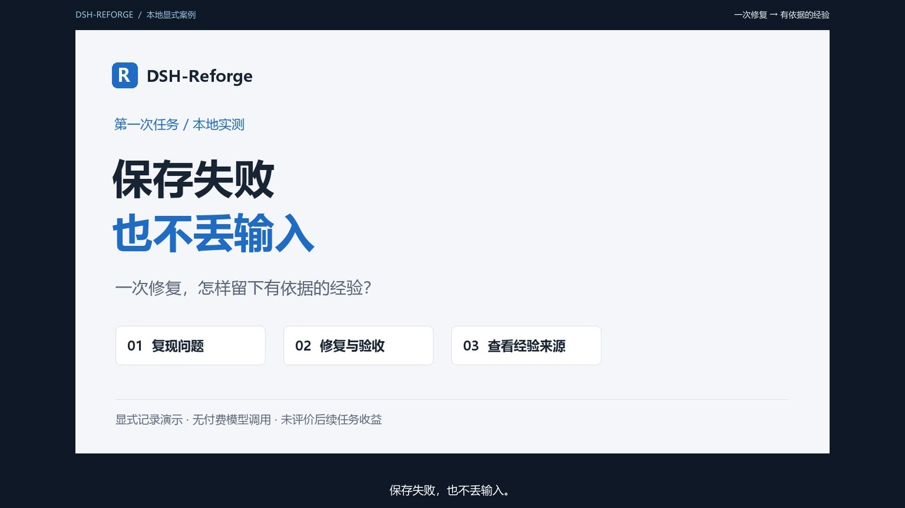

# First-task demo: keep user input when saving fails

**Reproduce it yourself:** the [complete customer-form project](../../examples/customer-form/README.en.md) includes the same bug, patch, independent tests and workbench entry. No key is needed. Continue with [first configuration and verification](../getting-started/quickstart.en.md).

[中文](first-task.md) · [Download video](https://github.com/wang1299/dsh-reforge/raw/refs/heads/main/docs/assets/demos/first-task-demo-1080p.mp4) · [English subtitles](../assets/demos/first-task.en.srt) · [Chinese subtitles](../assets/demos/first-task.zh-CN.srt)

The 2:02 video is 1920×1080 at 30 fps, with synthetic Chinese narration, burned-in Chinese captions, and chapter labels. Follow the poster to download the MP4 and play it locally. The GitHub file page does not provide inline playback for this video. The separate English SRT can be loaded in a compatible player. Browser frames were captured at approximately 4–6 fps and converted to 30 fps; some waits were cut and still sections are held for reading and narration.

## The problem

A customer form contains a name, phone number, and follow-up note. The program calls `draft.clear()` before contacting the save service. When that service fails, the user's input has already disappeared. The explicit correction is: **preserve every input on failure, show the error, and allow a manual retry; clear the form only after success is confirmed.**

The patch moves draft clearing to the successful-save path. The recording page calls a real local endpoint that injects a save failure, applies the actual patch, and checks the result again. After the service recovers, a double-click adds only one request; the form is cleared after that save succeeds.

## What actually ran

| Step | Recorded result |
|---|---|
| Reproduction | Local fault injection makes the save fail; the original version clears the input too early |
| Explicit correction | The real service records the correction and cites it as the source of the candidate fact |
| Repair | Codex prepares the patch; the demo page applies it to a synthetic Git repository and commits the fixed version |
| Browser checks | The same failure preserves all three inputs; a successful retry clears them; a double-click adds one request |
| Independent acceptance on the original version | 2 tests, 2 failures, no errors or skips |
| Same acceptance on the fixed version | 2/2 pass, no errors or skips |
| Repository regression tests | 3/3 pass, no errors or skips |
| Experience | The real DSH-Reforge verifier and service produce one source-verified experience, inspected in the standalone workbench |
| Later tasks | No applications or feedback; future-task benefit is not evaluated |

Acceptance tests are outside the target fixture repository. The verifier replays the original and fixed Git revisions. The experience status comes from actual verification, without direct SQLite edits to manufacture a pass. See the [bounded acceptance summary and asset hashes](first-task-evidence.json).

## Scope of the demonstration

This is a **local explicit-recording** workflow. The recording page's step buttons call the real service. Codex prepares the patch before recording, and the page applies it. The video does not record DSH autonomous coding, automatic capture from ordinary dialogue, or model-based automatic extraction. It is not an end-to-end recording of the DSH Web/Desktop host.

The UI is the standalone workbench from the alpha.2 source candidate at the [T044 merge](https://github.com/wang1299/dsh-reforge/commit/dd8a0fd17290062f4a5da5763b1b0f323ea8d39a). **Adding this video does not publish an alpha.2 installation package.** The public npm alpha.1 installation and host scope remain as documented in the [installation guide (Chinese)](../installation.md).

All customer data is synthetic. No private experience, credentials, or real customer systems are used; there are no paid model calls or increases to the user's budget or extraction grants. The repository includes only the final video, poster, captions, and bounded summary, without local authentication URLs, databases, or full conversations.

Source verification establishes that **this repair passed these checks**. It does not certify the strategy as universally correct or prove adoption or improvement in a later task. Automatic-workflow configuration and limits are documented separately in the [product requirements (Chinese)](../product.md) and [installation guide (Chinese)](../installation.md).
