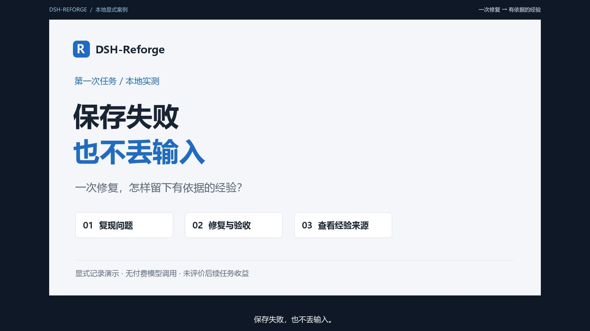

# 第一次任务演示：保存失败，也不丢输入

[English](first-task.en.md) · [下载视频](https://github.com/wang1299/dsh-reforge/raw/refs/heads/main/docs/assets/demos/first-task-demo-1080p.mp4) · [中文字幕](../assets/demos/first-task.zh-CN.srt) · [英文字幕](../assets/demos/first-task.en.srt)

视频长 2 分 02 秒，1920×1080、30 fps，含中文合成旁白、烧录中文字幕和章节。点击封面直接下载 MP4 后播放。GitHub 文件页不内嵌播放本片；独立字幕可用于支持外部 SRT 的播放器。录屏源帧约 4–6 fps，成片转为 30 fps，部分等待已剪去，静止画面为阅读及旁白适当停留。

## 这次解决什么问题

客户表单填写了姓名、电话和跟进备注。保存服务不可用时，程序却已执行 `draft.clear()`，用户刚输入的内容因此丢失。明确纠正是：**失败时保留所有输入、显示错误并允许手动重试；只有确认保存成功后才能清空。**

修复把清空草稿移到保存成功分支。录制页面实际调用本机接口制造保存失败，再应用真实代码补丁并复测。服务恢复后双击保存，只新增一次请求，成功后才清空表单。

## 实际演示流程与结果

| 环节 | 本次实际发生的事 |
|---|---|
| 复现 | 本机故障注入令保存失败，修复前输入被提前清空 |
| 明确纠正 | 通过真实服务接口记录这次纠正，并作为候选事实的来源 |
| 修复 | Codex 准备补丁；示例页面应用到合成 Git 仓库并提交修复版本 |
| 网页复测 | 相同失败保留姓名、电话和备注；恢复服务后成功保存；双击只新增一次请求 |
| 原始版本独立验收 | 2 项测试，2 项失败，0 项错误、0 项跳过 |
| 修复版本同一验收 | 2/2 通过，0 项错误、0 项跳过 |
| 仓库内回归 | 3/3 通过，0 项错误、0 项跳过 |
| 经验记录 | 真实 DSH-Reforge 验证器与服务接口生成 1 条来源验证通过的经验；在独立工作台展开测试依据 |
| 后续任务 | 0 条应用、0 条反馈；未评价未来任务收益 |

验收位于目标示例仓库外，验证器分别重放原始和修复 Git 版本。插件状态来自实际验证结果，没有直接编辑 SQLite 制造“通过”。媒体摘要及文件散列见[有界验收摘要](first-task-evidence.json)。

## 如何理解这段演示

本片是**本地显式记录**流程。录制用的步骤按钮调用真实服务接口；补丁在录制前由 Codex 准备，再由示例页面应用。它没有录下 DSH 模型自主编程、正常对话自动采集或模型自动提炼，也不是实际 DSH Web/Desktop 宿主的端到端录像。

界面来自 [T044 合并源码](https://github.com/wang1299/dsh-reforge/commit/dd8a0fd17290062f4a5da5763b1b0f323ea8d39a)的 alpha.2 候选，展示独立工作台。**发布这段视频不代表发布了 alpha.2 安装包**；npm alpha.1 的安装和宿主范围仍按[安装指南](../installation.md)。

全部客户资料为人工合成数据。没有使用私人经验、凭据或真实客户系统，没有付费模型调用，没有增加用户的预算或提炼授权。仓库只保存成片、封面、字幕和有界摘要，不包含本机认证地址、数据库或完整会话。

来源验证说明**这次修复通过了这些检查**。它不认证自然语言策略普遍正确，也不证明经验已被后续 Agent 采用或改善了任务。自动流程的配置和适用边界另见[产品需求](../product.md)与[安装指南](../installation.md)。
