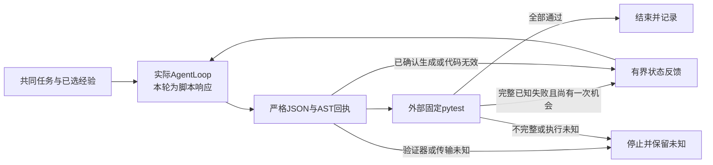

# 有界修复控制器：脚本演练，不是模型收益

2026-11-09，T062 / [Issue #137](https://github.com/wang1299/dsh-reforge/issues/137)。[ADR056](../decisions/056-bounded-agent-repair-study.md)先于实现；沿用[T061冻结新题](benefit-preparation-v1.md)，不改6题、策略、验收或36项顺序。

T061检查“模型实际收到什么”，本增量补“收到响应后怎样独立验收和有限返工”。**当前固定使用内部脚本adapter，尚无live入口、费用账本或新的预算授权。脚本返回作者答案不能证明Agent能力提高。**



最多2个明确修复回合，每回合恰好1个请求，2048输出上限、温度0、无模型工具。第一回合通过就结束；只有已确认的生成/验收失败才能进行预定的第二次修复。idle、完整JSON、函数写入成功和模型“测试都通过”的自述都不等于任务验收。

## 必须区分的结果

| 状态 | 证据 | 后续 |
|---|---|---|
| accepted | 完整外部pytest全部通过、无跳过 | 结束 |
| tests_failed | 完整pytest回执明确有失败 | 若为首轮，可修一次 |
| invalid_output | 严格单code键JSON形状不符、重复键或超限 | 若为首轮，可修一次 |
| invalid_code | 受控Python正常结束，明确返回AST rejected | 若为首轮，可修一次 |
| execution_unknown | 验证器不可用/坏回执、验收不完整等 | 停止，不自动重试 |
| transport_unknown | 没有完整助手响应、断流或回合期限到达 | 停止，不自动重试 |

第二轮只给固定状态和至多8个有界测试名/状态；不提供测试源码、断言预期、参考修复或任意pytest输出。完整实际输入摘要包含assistant历史，不漏掉前一轮提案。每个trial重新建立上下文；只保存摘要、有界合成提案、测试名/状态和计数，不保存完整会话。

## 写入与未知边界

runner和controller共用[合成目标写入器](../../scripts/benefit-study-files.ts)。仅写新研究目录的project/target.py；contract和target的符号链接、多硬链接均拒绝。哨兵按文件描述符与身份读取，候选写独占新文件并同步，再原子替换；不跟随旧target链接截断原文件，Windows替换失败不回退截断。该机制防止试验误写已有链接，不是对抗任意并发文件系统攻击的沙箱。

AST准入只有完整accepted/rejected回执才算已知；Python找不到、启动失败或超时不是代码错误。直接open和调用别名反例被拒，但仍不能把AST当通用不可信代码隔离。真实模型执行还需要独立进程/文件系统限制与费用门槛。

## 已实现的演练与仍待验证的效果

针对演练覆盖6种脚本行为：首轮参考修复、错误→参考修复、一直错误、只有成功自述、非法代码、传输中断。它们用真实官方AgentLoop和真实外部pytest检查请求/返工计数；另有缺失验证器仅1请求、0执行、0返工探针，以及链接哨兵保持、重复JSON键等边界。

完整schedule演练对36项都故意先返回原错误函数，再返回作者参考修复，因此预定需要72次脚本响应。该结果只验证控制器按协议执行，不报告“成功率提升”“节省返工/费用”。none/plain/reforge仍用实际来源选择及统一输入；选择和执行共用同一个新合成仓库，但不是完整Desktop或生产host效果对照。

```powershell
npm run study:rehearse
```

命令只支持rehearse，在本仓库`.probe-work/t062-study-rehearsal/run-*`建立新目录，保留逐trial结果和controller-result.json。source/index/bank、相关源码、实际JS入口起止核对；记录runtime和method摘要，仍不等于live全部依赖冻结。报告分开记录已计划、已记录、缺失、未尝试、未知；无法核对丢失结果中的请求总数时写null，不当作0。中途失败返回不完整报告和非零退出，不自动重放。

本机最终完整检查351项（349通过、0失败、2项Windows符号链接权限跳过）、compat10/10；修正后36项/72脚本请求完整演练已终结，36个session独立，源码/实际JS/source head/index/bank保持。它们是工程验证计数，不是模型效果数字。独立审查及最终提交四组合CI的实际终态见[T062任务回执](../tasks/T062-bounded-study-runner.md)，不能继承早期脚本版本的通过。

下一步仍是实现受授权的真实provider、独立持久费用占额、完整冻结/计量与未知停机，再给owner具体预算方案。旧T049的已完成10元授权不复用，本轮未读Key、旧profile、历史学习/费用/提炼记录，也未发付费请求或新发行物。

## English

This source-only controller uses the official AgentLoop and external pytest for at most two repair attempts. A complete known failure may receive one bounded feedback/repair turn; unknown transport, validator or execution never automatically retries. Strict one-code-key JSON, explicit AST receipts, in-scope atomic target replacement, independent acceptance and actual attempt/rework counts are separate boundaries. Self-report, idle and successful file writes are not acceptance.

The only adapter is an internal scripted oracle. The36-trial rehearsal deliberately emits the original error then an authored reference, so72 scripted responses demonstrate controller behavior, not model benefit, cost savings or improved success. No live endpoint, credentials, new financial grant or paid HTTP exists here. Input hashes include assistant history; source/compiled entry/runtime snapshots are preparation evidence, not complete live dependency freezing. Missing results stay explicit and unverified request totals are null.

Run `npm run study:rehearse` for fresh ignored local artifacts. A new durable cost ledger, authorized provider, frozen execution environment, current pricing and fresh spending permission remain required before real trials. See the task receipt for actual final checks and limitations.
