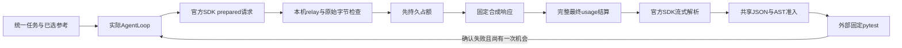

# 官方SDK本机线路：修复、验收与费用保护

[English below](#english) · [有界控制器](bounded-repair-controller.md) · [费用保护](study-cost-guard.md) · [ADR058](../decisions/058-official-sdk-study-wire.md) · [实际检查记录](../tasks/T064-official-sdk-study-wire.md)

本增量让实际官方DeepSeekAdapter经过同一套AgentLoop修复控制器。它请求固定的127.0.0.1模拟服务，响应为预设合成内容，**没有连接付费provider、读取Key或取得新预算**。不能用脚本答案通过率说明模型能力提升。

后续源码的固定授权、完整运行环境冻结与受限验收见[T065运行指南](authorized-benefit-study.md)；下文保留T064当时的检查范围，不作为T065完成证明。



| 验证对象 | 当前行为与边界 |
|---|---|
| 官方SDK实际通道 | 同时包装prepareCall和stream，避免只观察fallback而漏掉正式请求；保留其连接快照 |
| 请求参数与正文 | flash、非思考、温度0、2048输出、无工具；严格text-only，原始UTF-8字节和摘要一致，重复JSON键/BOM规范化被拒 |
| 模型、文件与认证 | 静态模型列表、固定本机地址、合成Bearer；新空Files索引与拒绝上传的fetch，不读取用户home索引或Key |
| 有限修复 | 原控制器最多两轮，完整已知失败才能修一次；成功由实际pytest回执决定 |
| 费用与取消 | 调用前占额；最终usage后结算；取消/截断/HTTP失败未知全额保留；真实SDK挂起时关闭本机服务也只请求一次 |
| 结果不可用 | 独立attempt仍记录已发生请求；清理未知则总数null并保留observed下界，不能以0掩盖已发请求 |
| 计数 | 本机HTTP、SDK请求、模拟transport、provider HTTP分别记录；本机HTTP不是零HTTP |

在Node24.19.0、Python3.10/pytest9.1.1及仓库固定依赖下，先保存并提交研究源码，使Git工作区干净：

```powershell
npm ci --ignore-scripts
npm run study:wire
```

命令只接受固定`offline-wire`，不接受live、Key路径或其他参数。每次创建新的`.probe-work/t064-sdk-rehearsal/run-*`，其中`offline-plan.json`绑定题目、顺序、系统、实际源码/JS/SDK入口及来源；`sdk-wire-result.json`记录各trial与attempt，不保存原始HTTP体或完整对话。源码manifest包含当前实际字节，不能仅用Git提交号代替它；尚未覆盖所有传递依赖或证明底层模型版本固定。

首次实现`607fe86`的实际本机演练完成36trial、72请求和72笔合成占额；单独核对脚本确认36个session、两轮失败→通过、wire摘要与账本顺序相同、源码/执行入口起止一致，参考数none/plain/reforge为0/12/10。这是旧SHA的线路证据；修正后的最终检查、两个平台与两个SDK图以任务/PR实际记录为准，不把旧回执改标新提交。

## 保留历史评测，另验当前依赖图

新增SDK开发依赖改变了当前lock文件。T059原method、数据、向量、源码和成绩保持；[原两锁资产](../../compat/project-facts/locks/README.md)仍精确符合旧摘要。原严格评测入口需要原图，可在对应历史源码（例如T063的`8533377`）中重建；不要用当前图覆盖历史输出。

当前源码使用独立回归入口：

```powershell
npm run retrieval:project-facts:regression
```

它分别核验历史资产、当前活动图与rc5图的所有既有包元数据，拒绝版本/integrity/依赖/peer/平台/engine漂移，再独立检查Schema标签并对照两分区五臂的全部保存结果。仅忽略dev/devOptional/peer安装分类标记；新增开发依赖必须是当前图同版本的官方SDK。它是当前扩展图的向量回归，不是原图重新执行ML或又一次首次留出实验，不重写旧成绩。

仍须完成：唯一固定账本的可信owner授权入口、完整真实执行冻结、真实网络取消/Key隔离和生成代码进程/环境限制。具体方案完成并复核后再申请新预算。旧T049授权不能复用，当前模拟金额不能作为真实费用或节省证据。

## English

The actual official DeepSeek SDK now traverses the shared bounded repair controller using a loopback-only synthetic service. Both prepared and fallback stream calls are observed; original wire bytes are checked before a durable reservation. Complete final usage settles synthetic accounting. Unknown transport, cancellation and incomplete usage stop the study without retry or replay. Per-attempt receipts survive a missing controller result; uncertain cleanup produces null totals and explicit observed lower bounds.

`npm run study:wire` runs the fixed36-trial schedule in fresh contexts, using authored original-then-reference responses. Local HTTP is counted separately from provider HTTP. The initial607fe86 rehearsal completed36/72 with zero provider calls; final-SHA validation is recorded separately. These figures prove wiring and controls, not real-model task benefit. No Key or fresh owner grant is loaded.

Original T059 method/data/vectors/results and dependency-lock bytes remain immutable. `npm run retrieval:project-facts:regression` verifies the extended graph and reproduces all saved vector-based results under that graph; it does not relabel it as the original ML or holdout environment. Full live freeze, trusted fixed-path authorization, network cancellation, credential isolation and code-process restrictions remain prerequisites to a newly approved paid study.
