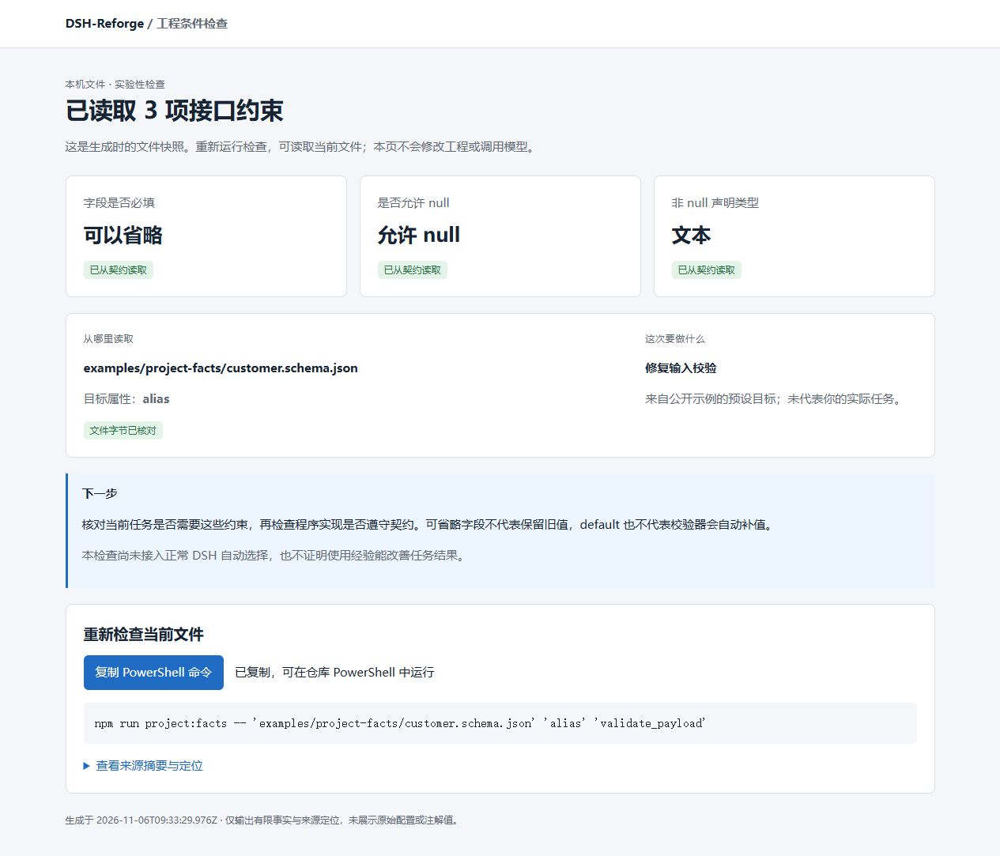

# 自动工程事实与明确目标：支持范围、收益及拒选代价

[文档导航](../index.md) · [ADR053](../decisions/053-project-schema-facts-and-goals.md) · [固定方法与重放](../../compat/project-facts/README.md) · [本地检查页案例](../../examples/project-facts/README.md) · [任务](../tasks/T059-project-facts.md) · [English](#english)

2026-11-06。新模块从真实文件字节读取有限Schema事实，并单独检查明确给入的任务目标。**下文是作者可见的合成工件留出，不是外部盲测、正常DSH对话或Agent收益。** 目标属性和目标种类仍是额外结构化输入；提醒是作者规则样本，没有因此获得来源验证资格。默认DSH、旧数据和公开npm包保持原状。

## 先看完整对照

留出48查询，24正例、24负例，4个新Schema工件模板；不是48个独立真实用户或未见问题族。

| 方法 | 正例正确提供 | 错误提供/全部 | 提供精确率 | 拒选/全部 | 覆盖率 |
|---|---:|---:|---:|---:|---:|
| 原dense，仅文字 | 7/24 | 9/48 | 7/16（43.8%） | 32/48 | 33.3% |
| 人工事实 | 17/24 | 5/48 | 17/22（77.3%） | 26/48 | 45.8% |
| 自动事实 | 14/24 | 5/48 | 14/19（73.7%） | 29/48 | 39.6% |
| 自动事实＋明确目标 | 11/24 | 0/48 | 11/11（100%） | 37/48 | 22.9% |
| 人工事实＋明确目标 | 14/24 | 0/48 | 14/14（100%） | 34/48 | 29.2% |

自动事实＋目标相对dense净多4个正确提供，但不是全保留：原7项保留5项、丢2项，另新增6项。丢失的是`inventory-count-unsupported_positive`和`inventory-count-missing_goal_positive`。**仍有13/24正例漏选；100%仅指这个合成对照中实际提供的11项，不是所有输入准确率、用户成功率或未来保证。**

## 分开看各项贡献

- 人工事实→自动事实：正确17→14，错误均5。自动子集损失3条原本可选的合法allOf正例：sensor-samples、inventory-count、billing-status；没有新增正确项。
- 自动事实→自动事实＋目标：错误5→0，正确14→11，损失同三工件的缺目标正例。明确目标输入有用，但没有被自动获取；不能用拒选来掩盖信息获取成本。
- 人工＋目标→自动＋目标：正确14→11，损失仍是那3条allOf正例，隔离了自动支持范围代价。
- 额外目标属性也是输入优势：事实臂可排除不同属性的提醒，dense臂只读文字。没有据此声称向量模型或自然语言理解变强。

| 留出正例种类（各4条） | dense正确 | 自动事实正确 | 自动＋目标正确 |
|---|---:|---:|---:|
| 直接描述 | 1 | 2 | 2 |
| 中文 | 1 | 3 | 3 |
| 次条件经验 | 0 | 2 | 2 |
| 低词面重合 | 3 | 4 | 4 |
| 合法但不支持的组合Schema | 1 | 0 | 0 |
| 相关但未明确目标 | 1 | 3 | 0 |

完整性探针（缺文件/过期摘要）与语义负例分开：dense为2/8错误，所有事实臂0/8。语义负例（单事实矛盾、UI目标、enum约束、文档目标）dense和自动事实均5/16错误；自动事实排除了条件矛盾，却仍误用在UI和文档目标上。带目标两臂为0/16。这不是仅靠来源哈希就能解决的意图问题。

每个控制组有相同文字的literal/单事实翻转/UI目标翻转三项，共4组。必须同时正确提供正例并拒绝对应负例才算解决该翻转：dense两类均0/4，自动事实为事实2/4、目标0/4，自动＋目标为事实2/4、目标2/4。剩余两组正例仍没选到。相同文字共用完全相同向量；优势来自额外输入。

## 自动读取到底覆盖了多少

每分区48输入中，来源绑定通过40/48，完整投影32/48（66.7%）；8个不支持（4个allOf、4个enum）、4个缺文件、4个过期摘要均保留未知。

| 字段 | 成功投影/全部输入 | 一致/成功投影 | 核对内容 |
|---|---:|---:|---|
| field_required | 32/48 | 32/32 | 独立完整Schema校验：省略字段能否通过 |
| field_nullable | 32/48 | 32/32 | 独立完整Schema校验：null能否通过 |
| field_type | 32/48 | 32/32 | 非null声明类型分类，独立于省略/null行为 |

96/96是**成功投影事实**的一致率，不是全输入覆盖100%。类型分类只描述声明；可选字段不能推出“保留旧值”，default不能推出标准校验会补值，Schema不能证明当前程序实现遵守契约。独立Ajv8.20关闭defaults/coercion/removal，无远程加载或自定义关键字，不是运行投影的依赖。

## 冻结顺序与全部材料

- 883f851先写设计；ce22567冻结96作者合成查询，摘要`44b0990bbc0e168666640a7c6ecb72625233bf9d49f1750c8fcdcb09b4955454`。两区各4工件/8提醒/48查询/24正例，属性和工件分离。根领域是已见JSON缺失/null问题；同模板与同Schema字节反复出现，每区仅20份不同Schema内容，不能按48独立样本计算推广可信度。
- 独立数据审查核对96实例/192省略-null探针及声明类型。核心开发与标签审查并行，在方法冻结/新数据推理/质量评分前完成；两项P2（继承属性、跨任务事实拼接）在5a1fc74和7307114修复。独立核心/方法增量预审通过。
- 0e6af32干净源码固定方法及两个宿主依赖图；d0684c0提交清单/开发向量。125f5f3保存并推送完整开发结果，Issue #131公开回执后才首次推理留出。c9f77e6干净源码执行首次留出，c103ac9保存全部结果。没有根据开发或留出调阈值、模型、规则或标签。
- 五臂共享原dense排序、分数0.5、原下一竞争项间隔0.025、top3；不搜索第4位补答案。事实臂共有来源可用/任务身份/修订/摘要/有界JSON门槛；人工仅额外解释支持子集外的合法工件，不能绕过缺来源/过期。独立oracle版本与两宿主lock固定。
- [开发全部结果](project-facts-v1-development.json)、[首次留出全部结果](project-facts-v1-holdout.json)、[方法清单](../../compat/project-facts/method.json)、[输入及人工标签](../../test/fixtures/project-facts-v1-cases.json)公开所有排序、条件、目标、来源、选择与失败。输入标签不参与自动决策；toy标签替换测试与完整评分重放分开。

开发dense/人工/自动/自动＋目标/人工＋目标正确5/13/10/6/9（分母24），错误16/4/4/0/0（分母48）；完整代价同样保留，没有只公布较好的分区。

两区各36段不同文字、56向量条目、5次真实本地CPU forward，共72文字/112条目/10次forward，**付费模型API0**。复用原固定MiniLM量化ONNX/384维/round7资产，无新模型下载。推理批次合计约0.438秒，不含准备/加载，不是服务时延分位数或真人耗时。CI用公开向量重放全部决定，不重新神经推理。

## 用户能直接运行什么

```powershell
npm run project:facts
npm run project:facts -- examples/project-facts/customer.schema.json alias present_ui
```

查看输出的本机HTML报告。默认目标标为“示例预设”；真实参数才标为明确输入，缺目标保持未知。报告给出三项约束、来源定位、静态时间、未知原因和可复制的重查命令，不回传原始Schema注解/default值。用户仍需文件/属性/目标，不是零配置或NLP。

实际浏览器：桌面、390×844、明确UI目标、不支持Schema、鼠标/键盘复制成功反馈通过；窄屏文档clientWidth/scrollWidth均375px，无横向溢出。手机三项约束以紧凑行显示。此轮没有做真人任务计时或深色主题走查。




核心/评价/预览12项针对测试及2项全部结果重放通过，类型/lint通过；新版宿主独立依赖安装/typecheck已过。最终全check/compat/四组合CI/稳定SHA评审与合并以[任务/关联PR](../tasks/T059-project-facts.md)实际回执为准。没有读旧profile、经验、授权、unknown或账本，没有发行新npm/Release。

## 下一道门槛

当前证据支持“有限事实可以从文件获取，明确目标能排除这批目标不匹配案例”，仍不支持正常DSH自动获知目标、完整Schema覆盖或真实任务收益。下一轮应让用户低成本明确/补充当前目标，并检验支持范围扩展对误选与漏选的共同影响；新方法要用新数据，不能把本轮已用留出继续叫新盲测。默认接入、已有经验条件编写与来源资格、真实Agent三组收益另验，费用另授权。

## English

On48 author-visible synthetic artifact-heldout queries (24 positives), dense/manual-facts/auto-facts/auto+explicit-goal/manual+goal correctly offered7/17/14/11/14 and wrongly offered9/5/5/0/0. Auto+goal retained5 of7 original correct offers, lost2 and gained6; coverage fell33.3%→22.9%, with13/24 positives still missed. Its11/11 precision is conditional on this small correlated synthetic experiment, not user success or a future guarantee.

Automatic projection supports32/48 inputs;96/96 projected facts agree with the reference, while16 unknowns remain in the denominator. Each of three fields projects32/48 and agrees32/32. Required/null behavior was checked with independent Ajv8.20 with all data mutation disabled; non-null declaration type is a separate check. Auto loses3 correct composed-schema cases versus manual input. Explicit goals remove5 wrong offers but lose3 correct missing-goal cases. Target identity and goals are extra structured inputs, not improved NLP; schema integrity is distinct from implementation correctness and downstream benefit.

Data/method/source/model/vector/dependency graphs were fixed before scoring, complete development results published before first holdout, and no retuning followed. The96 rows represent8 new schema templates in a previously seen JSON domain, with20 unique source contents per split, not96 independent users or a novel problem-family blind test. Ten real local ONNX forwards/72 unique texts/112 entries, paid model API0. Source CLI/HTML preview is runnable and separate from default DSH, old data, authorizations and the npm release. Full raw results, errors, paired flips and contribution losses remain public.
