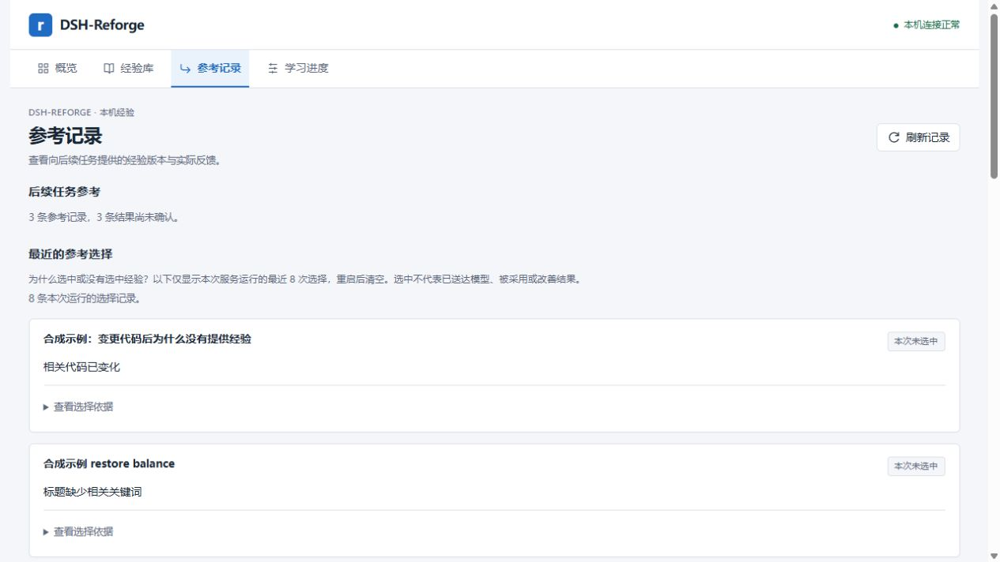
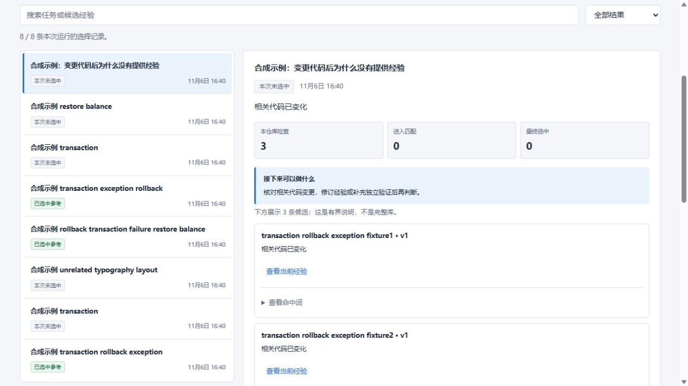
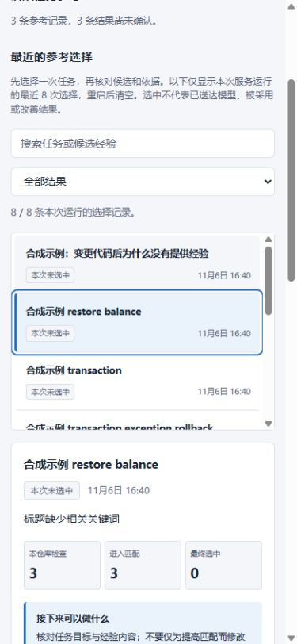

# 参考选择检查器：可复查的交互改进

2026-11-06，T058，设计见[ADR052](../decisions/052-reference-decision-inspector.md)，任务见[Issue #129](https://github.com/wang1299/dsh-reforge/issues/129)。这是源码候选，未发布新的npm包。

## 改了什么

沿用Tabler整体风格，将“参考记录”中纵向堆叠的选择说明改为任务列表和详情。用户先按任务摘要、候选标题或选中状态定位一次运行，再看结论、下一步、候选与依据；匹配分数和耗时渐进展开。搜索只读取当前最多8次运行的内存快照；每次最多展示5个候选，不能当作全库统计。选中不表示模型已收到、采用或任务成功。

信息组织参考[Dify的工作流追踪](https://www.dify.ai/workflows)和[Langfuse的trace详情与搜索](https://langfuse.com/changelog/2025-03-19-new-trace-view)。这是本项目针对有界选择数据的设计，不是复刻上述产品的完整功能。高星快照及决策保留于ADR；不引入第三方遥测。

## 实际观察与分母

浏览器对照：旧版源码`b928211da4ae93ab78e92ff8492b393bc12162ff`，新版UI源码`6d0626aa40430a72e84671af326c31cb2ddc4a0e`。两次启动使用相同合成工作负载，各自生成新UUID和时间；不是同一份字节完全相同的数据库。3个文本变体共用一份实际pytest验证的修复来源，不能算3条独立策略证据。

| 观察 | 旧版 | 新版 | 范围 |
|---|---|---|---|
| 从“参考记录”打开最新拒选候选的当前经验 | 2次点击 | 1次点击 | 点击“查看选择依据”后再开经验，变为直接开经验；不含认证、页签导航或滚动 |
| 当前合成运行 | 8次 | 8次 | 3次选中，5次未选中；不是模型任务成功率 |
| 选中筛选、无结果搜索、清除 | — | 3/8、0/8、8/8 | 清除后焦点回到搜索框 |
| 390×844视口横向溢出 | 未测 | 无 | 文档clientWidth和scrollWidth均375px；其余15px为纵向滚动条 |

上述点击数是脚本走查的动作数，不是用户研究、平均完成时间、认知负担下降或Agent收益。新版实际走查了键盘回车选择、窄屏上下布局、无结果恢复和普通轮询保留选择。新增快照/记录淘汰后的选择及焦点回退由针对测试覆盖；没有把静态浏览器观察当作所有状态变化的现场验证。实际浏览器截图为浅色主题；主题变量沿用原生适配，未新增深色浏览器截图。

旧版：



新版桌面：



新版窄屏：



## 自己运行同样的工程

需要源码开发环境：Node24、Git、Python3.10及pytest（详见[安装指南](../installation.md)），然后在仓库执行：

```powershell
npm ci --ignore-scripts
npm run panel:demo
```

打开终端本次生成的本机地址，进入“参考记录”。按Ctrl+C结束；不要分享带认证信息的启动地址。也可只做自动验收：

```powershell
npm run panel:demo -- --check
```

入口每次在忽略目录`.probe-work/inspector-demo`创建新合成工程，用真实来源验证、选择服务与面板完成8次运行；更改代码后最后一次拒选。检查输出应为`status: passed`、8次运行、3个共享同一来源的变体、3条应用记录、0条反馈、0次付费API调用。读取面板前后应用/反馈数量不变。不会读取用户profile、Key、旧经验、预算或授权；此源码演示不包含在npm安装包中。

## 验证与限制

面板针对测试28/28通过，包括本地筛选、保留旧选择、记录淘汰后行/候选按钮/折叠标题的焦点回退、无结果清除焦点、候选截断措辞和零写请求。自动演示实际通过。首次完整检查为287项：284通过、2失败、1项Windows符号链接权限跳过；两项失败来自既有预算测试中的本机HTTP连接关闭和临时文件rename EPERM，不涉及真实费用或私人账本。该测试文件单独复核11/11通过，未修改财务逻辑；完整复核及最终四组合CI、独立稳定提交审查以[PR与任务回执](../tasks/T058-decision-inspector.md)记录为准，不能将单文件复核视为完整通过。

默认选择算法、SQLite v9、旧数据和预算授权保持。下一步是从工程Schema获取有限、可核实的事实，再检查明确任务目标；需要新数据和独立校验对照。当前界面改进不解决已有适用性漏选，也不证明实际Agent成功率提高。

## English

The read-only inspector keeps the existing Tabler layout and bounded runtime data: up to8 attempts and5 candidates per attempt. Local search and outcome filters lead to a selected attempt, conclusion, next step, candidates and progressively disclosed technical detail. No selection or write is triggered by reading/filtering.

In a scripted real-browser synthetic walkthrough, opening the latest abstained candidate's current experience took2 clicks before and1 after, excluding authentication, tab navigation and scrolling. This is an action count, not human usability research or downstream Agent benefit. The3 variants share one actual pytest-verified repair. At390×844, document client/scroll widths were both375px with no horizontal overflow. Run `npm run panel:demo` or `npm run panel:demo -- --check` from source with Python/pytest available. Each run creates isolated synthetic data, makes zero paid model calls and does not open a user profile or ledger. The npm release is unchanged.
